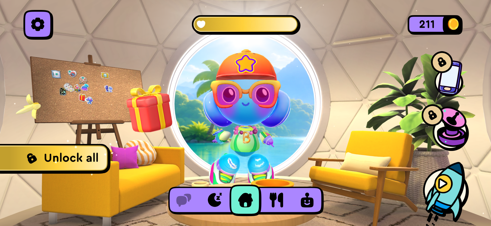
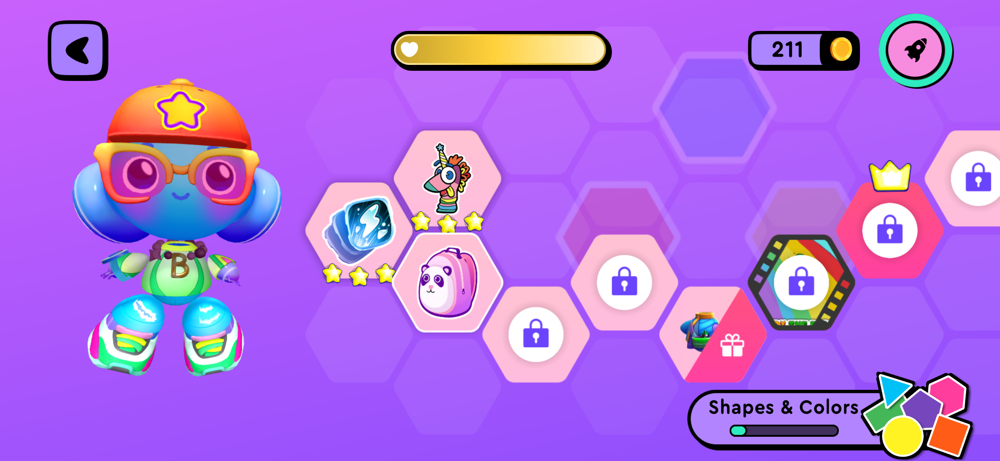

# Milo 儿童端界面设计规范

版本：1.1 · 2026-11-03（Demo 实装 0.4.8）  
适用范围：3–8 岁英语启蒙 App；首页、书架、旅行册、单元地图、学习活动与伙伴奖励的后续设计和开发。  
主设计画布：2400×1600，3:2；组件基准舞台为 75rem×50rem，在 1rem=16px 时对应 1200×800 逻辑尺度。

## 1. 本轮设计结论

首页采用“伙伴空间”：Milo 位于正中，小型对话气泡承担当前单元的开始或继续入口；右下角火箭进入学习地图。地图采用“左侧伙伴、右侧横向路径”：每个六边形对应一个完整学习单元，向右滑动能看到更多单元。

首页和地图顶部使用同一条 Milo 开心值。完成一个学习小环节获得爱心，表达一起完成事情的喜悦。开心值不表示英语能力、正确率或掌握程度。

整体使用明亮、低细节的背景、具有实物感的原创角色，以及带轻微玻璃质感的悬浮控件。场景负责提供氛围，气泡负责明确下一步；学习内容进入单元后再展开。书架、今天、旅行册共用固定的顶部工具与底部导航，切换时只更新中间内容。

本规范中的尺寸、颜色、奖励数值均为 **Milo 的设计选择**，不是从竞品反向测出的官方 token。用户本轮已明确选择 Buddy.ai 的页面关系；此前三版候选图不再作为目标。

## 2. 参考证据与取舍

| 来源 | 本轮可直接确认 | 对 Milo 的采用方式 | 不据此推断的内容 |
| --- | --- | --- | --- |
| 用户提供的 Buddy.ai 首页实机截图 | 主角居中；顶部心形状态条；独立的悬浮功能区域；底部导航；右下火箭 | 借用角色、快速开始、地图入口之间的空间关系 | 不凭截图猜测每个按钮功能、心形值算法和首次启动流程 |
| 用户提供的 Buddy.ai 路径实机截图 | 左侧主角；右侧连续六边形节点；完成、奖励、锁定的不同状态 | 每个六边形改为完整单元；支持横向滑动；伙伴为当前单元提供引导 | 不把截图中的星级、金币或锁定直接解释为本产品能力分或付费规则 |
| Buddy.ai 官方产品说明 | 官网介绍语音互动、游戏化学习，以及热身、引入、练习、情境应用的课程组织 | 让伙伴参与每次活动，单元内保留清楚的学习结构 | 不采用官网营销评分来证明界面优劣或教学成效 |
| Tolan 官方角色设计文章 | 其团队以具身、表情与动作探索陪伴关系；文章发表于 2025-02-26 | 角色有迎接、等待、鼓励、庆祝等状态；共同经历可延续到下一次 | 不将通用 AI 伙伴的开放聊天或成人用户测试结果直接用于儿童课程 |
| Lingokids 官方路径说明 | 2023-02-28 的文章描述从一个活动进入引导路径 | 活动之后给出明确的下一步，同时保留自由探索 | 这是一篇历史设计说明，不视为已登录核验的当前首页布局 |
| Apple 当前 Materials 指南 | 玻璃材质用于区分悬浮的控件和导航层；强调节制使用、保持可读性 | 顶部控件和底部导航轻玻璃；内容卡、气泡采用高不透明度底色 | 不把 CSS 模糊效果称为原生 Liquid Glass 的完整实现 |

官方来源：[Buddy.ai 产品说明](https://buddy.ai/en/)、[Tolan 角色设计文章](https://www.tolans.com/relay/designing-tolan-part-1-characters)、[Lingokids 路径说明](https://lingokids.com/blog/posts/introducing-the-new-playlearning-experience-on-the-lingokids-app)、[Apple Materials](https://developer.apple.com/design/human-interface-guidelines/materials)。这些页面于 2026-11-03 核对；官网说明和用户截图分别承担不同证据作用。

用户实机参考：

## 3. 尺度、画布与栅格

- 所有下述尺寸均以 **75rem×50rem 舞台、1rem=16px** 换算，即 1200×800 逻辑尺度；表内为本版 `buddy.css`、`theme.css` 与 `collections.css` 的最终生效值。制作两倍尺寸设计稿时可乘 2，但运行时根字号会根据视口与外侧安全区缩放，实际 CSS 尺寸应为 rem 值乘以当时根字号，不能把 2400×1600 预览视口直接等同于 1200×800 舞台的精确两倍。设备物理分辨率、CSS 视口和系统像素密度分别处理，不能直接把物理像素当作触控尺寸。
- 浏览器缩放调试固定 2400×1600 画布，只在外层改变显示倍率；1%–200% 是调试工具的查看倍率，不是儿童实际使用时的触点标准。
- 顶部工具区的实装边距约为左右 30、顶部 26；地图内容左右内边距约 34。后续组件以约 32 的安全边距为基准，主要组件之间优先保留至少 16，独立功能区域至少 24。
- 间距使用 4 的倍数：8、12、16、24、32、48。主要控件不依赖临时的单像素微调维持对齐。
- 主要内容采用 3:2 横向构图。功能控件固定在稳定锚点；窗口变大时同步调整内容和触点，而不是只增加四周空白。

### 首页区域

下表是本版实装的组件槽位；角色图片盒包含透明边缘，不等同于可见角色轮廓，气泡高度随实际文案变化。

| 区域 | 本版逻辑坐标或尺寸 | 布局规则 |
| --- | --- | --- |
| 顶部左侧设置 | 3.5rem×3.5rem，约 56×56；距左 1.85rem≈30、距顶 1.65rem≈26 | 独立悬浮按钮，不与场景物品混淆 |
| 开心值 | 顶部居中，宽 23.5rem≈376、最小高 3.6rem≈58 | 心形图标、进度和清楚的名称一起出现 |
| 顶部右侧工具 | 图标按钮约 56×56；家长按钮高 56、宽随标签适配 | 与设置保持相同按钮家族；儿童当前学习不以进入家长区为前提 |
| Milo | 图片盒宽为舞台 43%，上限 32rem≈512；高为舞台 67%≈536；顶部 19%≈152，水平居中，盒中心约 (600,420) | `theme.css` 的最终覆盖值；角色是第一视觉焦点，透明图实际轮廓须与气泡、导航一起检查 |
| 快速开始气泡 | 宽 18.9rem≈302；高度随文案约 100–130；左侧锚点为舞台 58%≈696，顶部 18%≈144 | 包含一句邀请、单元名和一个开始/继续动作；整块可点，避免气泡里再塞多个入口 |
| 底部悬浮导航 | 宽 24rem≈384、最小高 4.35rem≈70；底部居中，距底 1.65rem≈26 | 书架、今天、旅行册；“今天”居中并有明确选中态 |
| 火箭地图入口 | 整体宽 10rem≈160，含标签内容高度约 210–225；火箭图约 147×162；距右 3rem≈48、距底 6.25rem≈100 | 图像、点击底座与“学习地图”标签形成一个整体；与中间导航留出间隔 |

首页只保留一个主要学习行动。首日显示“开始”；中断后显示“继续”；完成后可进入下一个 **已实现且可用** 的单元。全部可用内容完成后提供重读、共同旅行页或地图，不伪装成已有新课程。

本轮 Demo 范围为两个真实完整单元：“准备野餐”和“早餐小帮手”。第一单元完成后解锁第二单元，首页气泡推荐下一项真实可用内容。地图另外四个节点为明确标注的规划占位，不代表六个单元都已实现；两个单元都完成后提供重读与共同作品入口。

### 地图区域

| 区域 | 本版逻辑尺寸 | 布局规则 |
| --- | --- | --- |
| 顶部栏 | 工具高约 56、开心值最小高约 58；地图主体上内边距 7.1rem≈114 | 左上返回；中间开心值位置与首页一致；工具位置稳定 |
| 左侧伙伴栏 | 栅格首列为内容区的 24%，含页面内边距后的视觉区域约占画布 25%；在基准舞台中列宽约 272 | 角色固定在左侧，不随地图滑动；角色图最终为伙伴栏宽度的 160%（约 435）、高 29rem≈464，允许占用栏外留白，不能误读为画布宽度的 160% |
| 右侧地图视窗 | 画布宽度约 69%–70%，基准舞台中约 834；两列间隔 1.7rem≈27 | 横向滚动，伙伴与顶部栏不随地图一起滑出屏幕 |
| 六边形节点 | 六边形图块 12.8rem×11.25rem≈205×180；完整节点按钮宽 13rem≈208，含名称与状态最小高 18rem≈288；相邻中心横距约 230 | 上下交错偏移各 2.9rem≈46，奇偶节点中心的高差约 93；同一节点的图、名称、状态、活动进度归为一组 |
| 右侧内容暗示 | 首屏可露出下一个节点的一部分 | 同时提供左右按钮和“向右探索”提示；不能只依赖隐藏滚动条 |
| 底部辅助区域 | 使用少量主题名或当前单元信息 | 地图页优先保留返回路径，不再用第二套大量入口争夺注意力 |

地图滑动支持手指、鼠标拖动或滚轮、键盘和左右箭头。初始视窗保留起始区域，不把已完成的第一单元裁掉；通过滑动或左右按钮查看后续当前单元，后续可记住上次的浏览位置；本轮 Demo 重新进入时按当前可学单元定位，并保留起始单元可见。点击当前或已完成单元先展示单元信息，再开始或继续；规划中单元明确说明尚未开放。

窄屏使用独立布局覆盖，不把上表整体缩小到不可触控：导航宽约 272、最小高约 61；顶部图标触点为 44×44。首页角色盒宽为舞台的 88%，高为 52%，顶部 29%。地图伙伴图约 117×131；六边形图块约 144×126，完整节点宽 144、最小高约 221。缩放调试仍保持固定画布，只改变外层查看倍率。

## 4. 色彩与可读性

### 基础色板

| Token | 色值 | 用途 |
| --- | --- | --- |
| `cream` | `#F8F6F1` | 主背景、内容底色；占界面最大面积 |
| `ink` | `#283647` | 奶白、高不透明度玻璃、淡色内容上的主要文字 |
| `ink-strong` | `#1D2633` | 饱和紫色底上的小字、关键图标 |
| `lavender` | `#8F80F8` | 品牌识别、当前节点、局部装饰；不要大面积压住内容 |
| `lavender-light` | `#CEC5FF` | 地图浅底、当前单元的柔和底色 |
| `purple-action` | `#6554C0` | 需要白字的主要行动按钮 |
| `mint` | `#9DE1D5` | 伙伴、已完成状态的柔和底色 |
| `coral` | `#FF977D` | 爱心、局部温暖强调；不同时承担所有主要按钮 |
| `butter` | `#F6CF65` | 开心值填充、少量奖励高光 |

同屏使用一项主要行动色，其余颜色承担状态与氛围。色彩占比可以参考：浅色和中性色约 70%，紫与薄荷约 20%，珊瑚和黄色约 10%；这是一条构图控制线，不是需要逐像素计算的指标。

### 文字对比度

普通文字目标至少 4.5:1，大字至少 3:1，依据 [W3C WCAG 对比度说明](https://www.w3.org/WAI/WCAG22/Understanding/contrast-minimum.html)。以下为纯色组合按相对亮度计算的近似值，不代表半透明叠图后的最终结果：

| 文字 / 底色 | 约对比度 | 使用结论 |
| --- | --- | --- |
| `#283647` / `#F8F6F1` | 11.38:1 | 主要正文可用 |
| `#283647` / `#CEC5FF` | 7.64:1 | 地图、气泡正文可用 |
| `#283647` / `#9DE1D5` | 8.29:1 | 薄荷底正文可用 |
| `#283647` / `#FF977D` | 5.84:1 | 珊瑚底正文可用 |
| `#FFFFFF` / `#6554C0` | 5.86:1 | 深紫主按钮可用 |
| `#1D2633` / `#8F80F8` | 4.80:1 | 饱和浅紫底小字可用 |
| `#FFFFFF` / `#8F80F8` | 3.18:1 | 不用于普通小字 |
| `#283647` / `#8F80F8` | 3.87:1 | 不用于普通小字；改用更深文字或更浅底色 |

玻璃按钮最终要在真实背景上检查。模糊并不能保证对比度；低对比的图片部分经过控件下方时，可读性仍必须保持。

## 5. 字体、图标与触点

| 类型 | 逻辑字号或尺寸 | 规则 |
| --- | --- | --- |
| 地图主标题 | 1.65rem≈26，粗体 | 首页角色空间不另放大标题，避免与气泡竞争；学习活动页标题按内容模板定义 |
| 气泡主文案 | 1.18rem≈19，半粗体 | 一到两句；优先短句和明确动作 |
| 单元名、导航标签 | 单元名 1.05rem≈17；导航标签 .85rem≈14，半粗体 | 图形与文字同时传达功能 |
| 辅助说明 | 首页、地图本版约 11–12 | 不承载孩子完成任务所必需的信息；不能以调试截图中的放大像素当作字号 |
| 主要学习触点 | 气泡整块约 302×100–130；单元整块约 208×至少288 | 图像、文字与状态属于同一可点击区域，不仅图标本身可点 |
| 导航与次要触点 | 导航单项约 116×54；工具图标按钮 56×56；移动端图标按钮 44×44 CSS px | 图像可以小，实际可点击范围保持足够大 |
| 主要图标 | 工具图标 1.65rem≈26；导航图标 1.5rem≈24；单元图标 3.5rem≈56 | 统一图标家族与笔画粗细；不混用多个风格的线性和填充图标 |

中文优先使用系统中文无衬线字体，英文使用相同视觉重量的系统圆润字体。不要依赖外部字体加载才能正确排版。关键入口使用“图标 + 简短标签 + 可重听语音”；孩子不必先认识“继续”“路径”等字词才能完成操作。

## 6. iOS 悬浮控件与内容层

采用三层结构：背景场景 → 伙伴和学习内容 → 控件与导航。参照 Apple 材料指南，玻璃质感集中在功能层，避免每个内容块都透明发亮。

- **导航与工具按钮**：浅色半透明底、细亮边、柔和阴影；本版工具圆角 1.15rem≈18，气泡与导航外壳圆角 1.6rem≈26。玻璃模糊分别约为工具 16px、导航 20px、气泡 14px，均以基准根字号换算，仅作为 Web Demo 的视觉参数。
- **气泡和学习单元**：使用约 92%–98% 的不透明浅色底，保护文字和图像；边界清楚，阴影比背景明显。
- **阴影**：同一光源，控件采用低透明度、宽扩散阴影；避免黑色粗描边和多层强立体挤压一起出现。
- **按压**：轻微缩至约 0.97 或降低悬浮高度，持续约 120–180ms；反馈不改变按钮位置。
- **选中**：底色、图标和小标签共同变化。未选中控件仍清楚可见，不因透明而难以发现。
- **减少透明度**：提供实色底的回退；背景模糊不可用时仍应完整可用。

首页火箭可以保留立体玩具感，点击范围由统一的悬浮底座和标签说明。不要把房间的所有道具都做成看似可点的按钮。

## 7. 背景与伙伴的复杂度

背景允许大圆窗、柔和墙面、地面，以及少量低对比的书台或植物。中央留出角色活动空间。首页首屏不同时放金币、礼物、装扮商城、排行榜和多个锁定功能。

背景遵循四条检查：

1. 缩成预览缩略图时，先认出 Milo、气泡和火箭，再看到装饰。
2. Milo 身体外轮廓背后尽量安静；窗框、家具线和图案不穿过脸部。
3. 场景装饰不能使用与主要操作相同的强饱和色和阴影重量。
4. 学习地图使用更平静的浅色底；路线、六边形和当前节点成为主要信息。

Milo 是原创伙伴资产，不直接截取 Buddy.ai 的机器人使用。角色保持同一比例、配色、材质和正面识别特征。本轮已接入统一迎接造型与轻微待机；后续最低状态集扩展为迎接、等待、鼓励、庆祝。关系感来自具体回应与共同经历，不靠增加背景摆件。

## 8. 单元、活动与地图状态

一个六边形 = 一个完整单元。以“准备野餐”为例，单元包含听读故事、听请求装篮子、表达选择、收好共同旅行页等活动。四项活动可以用节点中的四个小标记表达，不再各自画成一块同等级的大六边形。

| 状态 | 视觉与可操作行为 |
| --- | --- |
| 当前可学 | 本版使用暖黄浅底、薄荷开始状态和播放符号；只有这个节点承担最强强调 |
| 进行中 | 显示真实活动进度，点击继续；不因退出而重新计零 |
| 已完成 | 薄荷底、对勾、可回看；不产生未经观察的“已掌握”结论 |
| 已实现但顺序未到 | 锁形与说明共同出现；能查看原因，不能进入未到达的活动 |
| 规划中 | 低强调、明确“准备中”；不伪装为已实现、只待付费就能解锁的内容 |

路径完成进度、角色开心值、语言观察证据三者分别保存和呈现。孩子完成学习流程并不等于已掌握全部语言目标。

## 9. 开心值与爱心奖励

### 语义

开心值是伙伴共同经历的反馈。Milo 在没有学习、没有录音或离开 App 时仍然友好。角色不哭泣、不责怪、不因未完成任务变得饥饿或生病；不通过情感压力要求孩子返回。

开心值不倒扣、不随时间衰减，不与付费、连续签到天数、录音时长或答题正确率绑定。得到帮助后完成活动，与独立完成一样可以获得陪伴奖励；家长侧仍如实保留支持条件。

### 本轮默认事件表

本轮初始开心值基线为 20/100。每个单元含四页故事、三个请求、一次表达选择和一张旅行页，共九个可奖励小环节，合计加 20。这个初值表示伙伴的友好状态，不是学习成绩。实现时使用统一常量，避免页面各自定义数值。

| 活动完成事件 | 触发条件 | 奖励 | 不应触发的情况 |
| --- | --- | --- | --- |
| `unitId:reader-page-index` | 完成一页翻阅并向后推进；最后一页由阅读结束确认 | 每页 +2，共 +8 | 仅打开页面、开始播放、刷新或来回翻同一页 |
| `unitId:pack-targetId` | 完成一个请求，包含在帮助下完成的情况 | 每个 +2，共 +6 | 每次点选、同一题反复尝试、重玩已奖励的请求 |
| `unitId:expression` | 完成自己的选择；录音为可选 | +3 | 为奖励而强制开麦，或给录音者更多分数 |
| `unitId:memory` | 保存本单元共同旅行页 | +3 | 重开已保存页面、重复点击完成 |

本版每个单元的三个请求目标各出现一次，因此请求事件使用目标ID去重；若后续同目标出现在多个不同请求中，应改用独立请求ID并迁移旧键。

如果后续将活动拆为更小的学习环节，必须先定义明确的事件 ID 与上限，再调整奖励。不要用每次点击作为获得爱心的依据。

### 去重与反馈

- 用 `unitId + 事件 ID` 保存首次奖励记录，事件 ID 包含页或请求的标识；在同一次状态更新中写入环节完成与奖励记录。
- 刷新、恢复、返回首页、重读和重玩不能重复增加同一事件的数值。
- 升级旧存档时，根据真实已完成的活动补齐去重记录；启动时不重新播放历史庆祝动画。
- 开心值达到上限后，仍可以获得一次友好的完成回应；不要为了显示更高数字而突破量表含义。
- 正式多单元版本可以保存累计爱心与当前开心值两个字段，避免满值后奖励记录消失；儿童端只展示必要的一层信息。
- 小心心出现、向顶部移动或进度轻微填充，整体约 600–900ms；同时提供短文字“我们一起完成啦，+2 爱心”等真实奖励数值。声音遵循全局静音设置。
- `prefers-reduced-motion` 下取消飞行、弹跳和缩放，直接更新进度并显示文字。

## 10. 动效、无障碍与移动端

- 同时只发生一个主要反馈。首页不持续播放飞行、闪烁、礼物晃动和多处发光。
- 伙伴待机只保留轻微、低频动作；避免持续吸引视线离开当前学习任务。
- 锁定、当前和完成不能只靠颜色区分，同时使用图标、标签和可读名称。
- 开心值使用可读名称、当前值与上限；地图节点名称包含单元名与状态；语音按钮、地图火箭、返回键有明确无障碍标签。
- 键盘焦点清楚可见。地图左右按钮和节点可用键盘操作，弹窗关闭后回到合理的入口。
- 390px 等窄屏下，控件不按 2400 画布直接缩到不可点击。正常体验应改为适合触控的布局；调试预览允许很小的整体倍率，仅用于看构图。
- 窄屏首页保留顶部开心值、居中伙伴、气泡和火箭；减少装饰，底部控件不遮挡角色及主要行动。
- 窄屏地图保留一个较小的伙伴区域和横向地图。节点触点保持可操作，不能把多个完整单元挤成很小的多列清单。
- 手机和高像素密度设备分别检查实际 CSS 视口。正文放大、长单元名和系统减少动态效果设置都不应使主要操作不可达。

## 11. 后续页面复用与验收

新增页面必须复用色板、文字对比、触点、浮层和单元状态，不另外创造一套按钮系统。学习活动页可以用更纯净的内容底色，把伙伴缩到适当位置；家长中心以事实证据和清楚说明为主，不重复儿童场景或奖励装饰。

### 三个主 Tab 的统一约定

- **同一外壳：** 书架、今天、旅行册共用 `world-shell`、顶部开心值、设置、声音和家长入口。顶部与底部控件在切换时保留，只替换中间内容，避免页头重排、导航跳动或历史庆祝重播。
- **同一导航：** 顺序固定为书架、今天、旅行册，位置、尺寸、图标家族和标签重量一致。当前页同时更新选中底色与 `aria-current`，不能把今天永久标为选中。学习活动中的同款导航标记其来源主 Tab。
- **同一内容层：** 书架和旅行册使用低细节浅底、高不透明度圆角卡片、柔和阴影与同一 Milo 资产。书架表达可读、续读、已完成、尚未开启的真实状态；旅行册只展示真实完成的共同作品，空状态提供清楚的开始邀请。
- **固定控件，内部滚动：** 内容区为顶部与导航预留安全距离，长内容只在中间滚动，不随滚动推走导航。桌面可用两列，窄屏改为一列；不能为了保持两列把卡片和触点挤小。
- **保留位置与来源：** 在本次会话内记住各内容 Tab 的滚动位置。声音设置或切换 Tab 不应把书架拉回顶部；从书架或旅行册进入阅读后返回原 Tab。未完成故事继续上次页，已完成故事支持从头重读。
- **一致反馈：** Tab 切换可以有轻微内容淡入，不移动整个页面框架；减少动态效果时取消淡入。声音等短提示显示在导航上方，结束后清除，不遮挡主导航，也不因切换 Tab 增加爱心。

本版已按 2400×1600 和 390×844 CSS 视口检查导航稳定与内容留白；具体结果见 Demo 的 `design-qa.md`。该约定要求后续主 Tab 在空、进行中和已完成状态下都复用同一框架。

验收至少覆盖：

- 首页第一次看到时，Milo、学习气泡、地图火箭和底部导航主次明确。
- 书架、今天、旅行册往返切换时顶部和导航稳定，当前项正确；书架和旅行册空/有内容状态使用同一视觉系统。
- 各内容 Tab 的滚动位置可恢复；从两个内容 Tab 阅读后返回来源页，未完成故事续读位置正确。
- 当前单元、恢复中的单元、全部已实现内容完成后三种气泡状态都正确。
- 地图横向滑动、左右按钮、当前单元定位和规划中节点说明可用。
- 同一完整单元只有一个六边形；进入后再展示活动关系。
- 获得爱心、刷新去重、重玩去重、得到帮助仍可获奖、不录音仍可获奖。
- 角色开心值与家长语言证据没有混在一起。
- 2400×1600、1200×800、390px 窄屏以及缩放调试倍率均可查看；缩放后的拖动命中、声音弹窗和返回继续仍可用。
- 真实背景上的文字与图标可读；无透明效果、减少动态效果时仍可操作。

静态视觉检查用于确认布局和层级。儿童是否真正知道先点哪里、能否理解开心值和地图，需要后续真实试用观察；本规范不把设计推断写成已验证的学习效果。
