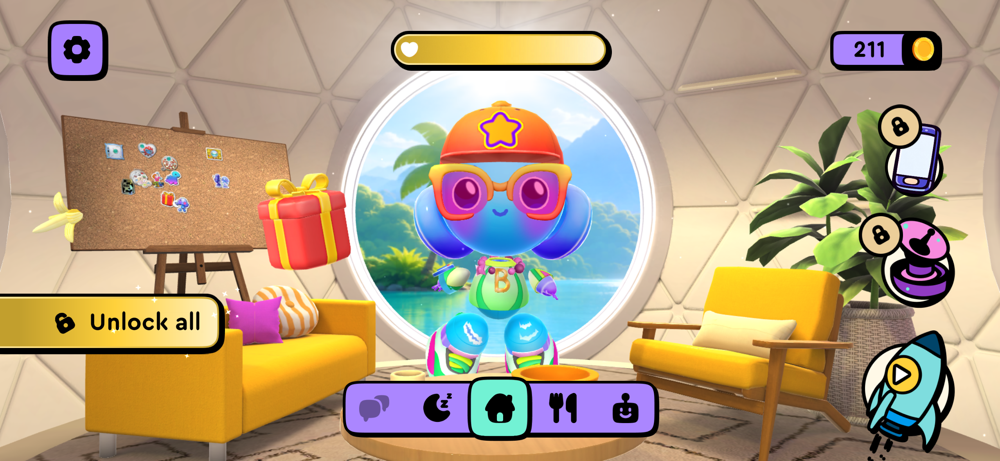
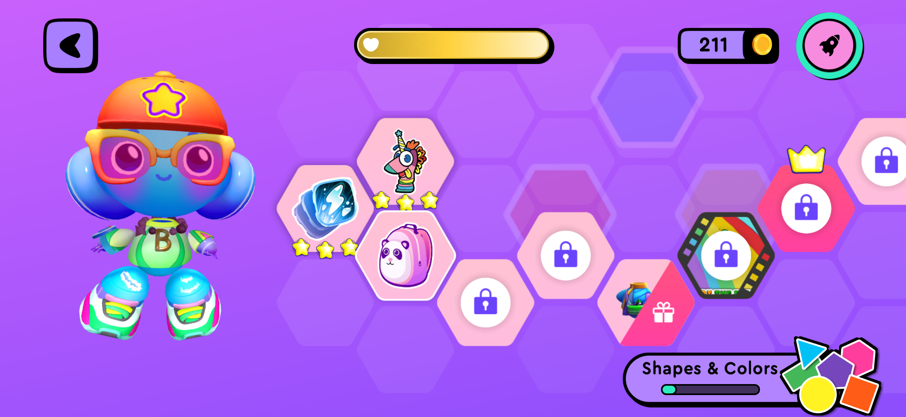
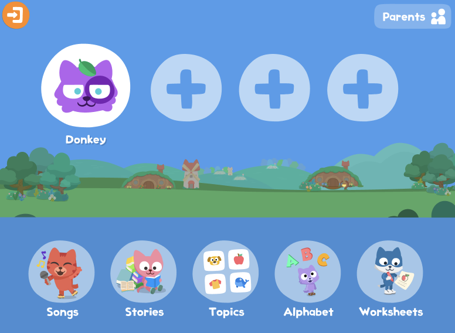

# 海外学习 App 首页调研与方案建议

日期：2026-11-02  
状态：调研结论与首页结构候选，供负责人选择。原三版视觉方案均未选定；原第 3 张仅为相对偏好，不作为编码目标。

## 1. 本轮要解决的问题

用户反馈：原三版过于像绘本，背景与场景细节过多，缺少明确的 App 首页感，不容易判断先看哪里、先点哪里。

本轮目标是明确首页的信息层级、可操作入口和角色关系。建议保留伙伴和故事世界，将首页组织为可立即开始、可继续、可返回的界面；完整故事与丰富情境在学习单元中展开。

研究覆盖直接相关的儿童启蒙产品、阅读与学习路径产品、伙伴产品及家长外教服务产品。它们承担不同参考作用，不按星级直接排首页优劣。

## 2. 证据范围

| 证据 | 可以说明什么 | 不能直接说明什么 |
| --- | --- | --- |
| 用户提供的 Buddy 手机实机截图 | 该使用状态下的首页与路径布局、控件及可见进度 | 首次启动流程、每个图标的完整功能、其他版本行为 |
| Studycat 官方新版首页帮助页及原图 | 官方展示的首页分类、个人档案和家长入口 | 全部儿童实际使用效果 |
| 官方帮助文档和设计文章 | 产品定位、设计意图、文档中明确描述的路径 | 未展示的当前页面布局 |
| 当前美国 App Store 页面与截图 | 定位、商店评分、官方展示的部分界面 | 登录后的所有流程、截图是否就是首次启动首页 |
| 商店公开评论 | 具体用户提到的体验线索 | 问题发生频率、用户代表性、学习效果因果关系 |

除用户提供的实机截图外，本次没有登录各 App 进行完整实测。应用商店画面包含宣传文案时，观察其中的界面，不把宣传画面本身称为首页。

## 3. 产品与口碑信号

评分均为 **2026-11-02 美国 iOS App Store 访问快照**，人数为页面显示的约数。商店分级与产品建议学习年龄分开看；以下评分是口碑线索，不是教学成效或首页清晰度的证明。

| 产品 | 定位与适用参考 | 评分 / 评分数 | 对本项目的参考价值 |
| --- | --- | --- | --- |
| [Buddy.ai](https://apps.apple.com/us/app/buddy-ai-kids-learning-games/id1255783056) | 3–8 岁语音 AI 启蒙与游戏 | 4.6 / 约 42K | 伙伴大厅、独立学习路径、任务与语音互动；用户实机截图证据最直接 |
| [Tolan](https://apps.apple.com/us/app/tolan-your-friendly-guide/id6477549878) | 日常 AI 伙伴；商店分级 13+，非儿童英语课程 | 4.8 / 约 188K | 角色存在感、关系定位与对话连续性；不作为儿童课程和开放聊天机制模板 |
| [Studycat English](https://apps.apple.com/us/app/learn-english-studycat/id428920239) | 儿童英语作为新语言的学习 | 4.5 / 约 1.9K | 功能分类、明确的独立控件、家长区；新版首页有官方原图 |
| [Khan Academy Kids](https://apps.apple.com/us/app/khan-academy-kids/id1378467217) | 2–8 岁阅读、数学和综合启蒙，非专门外语课程 | 4.8 / 约 133K | 大按钮启动个性化路径，同时保留自由 Library；结构贴近本项目 |
| [Ello 2.0](https://apps.apple.com/us/app/ello-2-0-learn-reading-math/id6739630070) | 5–9 岁阅读与数学，非专门 EFL | 4.5 / 106 | 浅色学习界面、日常课程节点、局部书图、单个问题与伙伴反馈；评分样本较小 |
| [Lingokids](https://apps.apple.com/us/app/lingokids-games-shows/id1002043426?platform=ipad) | 2–8 岁游戏、节目与多学科启蒙 | 4.3 / 约 677K | 内容发现、引导路径和家长进度；内容范围较广，首页入口数量需按本项目收敛 |
| [Novakid](https://apps.apple.com/us/app/novakid-english-school/id1475232382) | 家长管理儿童外教学习与安排 | 4.6 / 140 | 下一节课、老师、课前材料、反馈和录像；适合家长端参考，评分样本较小 |

Buddy 官网另有跨渠道评论汇总，与本表美国商店口径不同，未混入比较。Tolan 的高分也不用于推断适合 3–8 岁学习。

## 4. Buddy 实机截图的具体观察

### 4.1 首页：伙伴大厅

可直接观察到：

- 伙伴居中且体量突出，背景是其生活空间。
- 底部固定图标栏有明确选中状态，控件使用高对比色块和粗描边。
- 设置、金币、心形状态条、锁定图标与火箭等集中在稳定区域。
- 房间背景有细节，但按钮与主要图标在形状、颜色和描边上区别于背景。

这些视觉线索能帮助区分可操作对象与场景物品。具体图标功能和首页到路径页的实际点击顺序，仍需操作验证，不能仅凭图标推断。

### 4.2 路径页：学习进度空间

- 背景改为平面色彩，主要内容是学习节点与其状态。
- 伙伴缩到侧边，给路径让出空间。
- 已完成节点、星星、锁定节点、礼物等表达不同状态。
- 截图存在金币与多节点进度，属于已有使用状态，不代表新用户首日布局。

### 4.3 对本项目的设计推断

借鉴“伙伴关系页与学习路径分工”和统一的控件视觉语法。首日 Demo 进一步提供明确的当前任务与开始按钮；奖励状态是否需要另行验证。现有旅行册与共同作品可以先承担成果积累。

## 5. 其他产品中有依据的设计线索

### Studycat：分类清楚与家长入口独立

[官方新版首页帮助页](https://help.studycat.com/hc/en-us/articles/56252451236249-New-Home-Screen)展示个人档案和 Songs、Stories、Topics、Alphabet、Worksheets 分类，右上角为 Parents。[家长区说明](https://help.studycat.com/hc/en-us/articles/56254667130777-Everything-for-parents-in-one-place)进一步解释其集中管理入口。

对本项目的推断：保留一致的功能入口和家长区，但首页需要额外突出“当前推荐做什么”，因为分类清楚与第一行动清楚是两个不同任务。

### Khan Academy Kids：开始学习与自由探索并行

[官方帮助文档](https://khankids.zendesk.com/hc/en-us/articles/360014856151-Learning-Topics-Using-Khan-Academy-Kids-in-Educational-Settings)明确说明：首页大绿色按钮开始与 Kodi 的个性化学习路径；Library 和角色房间支持自由选择；返回时可用播放按钮继续。

对本项目的推断：一项清楚的“开始 / 继续”行动与自由书架可以同时存在，首页无需先呈现整个内容库。此处依据是官方流程说明，不宣称已登录核验其当前所有布局。

### Ello：内容局部呈现，每次集中一个问题

[官方商店截图](https://apps.apple.com/us/app/ello-2-0-learn-reading-math/id6739630070)展示浅色课程界面、较大的任务节点及书封；阅读页聚焦书图与短文本；对话页聚焦一张图、一个问题和伙伴回应。未确认日常课程画面就是首次启动首页。

对本项目的推断：书图和故事场景可以在当前内容区域出现，周围保留稳定、清楚的操作界面；伙伴在需要回应时更突出。

### Tolan：关系感来自角色与回应

[官方角色设计文章（2025-02-26）](https://www.tolans.com/relay/designing-tolan-part-1-characters)介绍了富表现力的动画角色及同伴定位的设计过程。其早期测试属于该产品用户的反馈，不能直接推广为儿童学习规律。

对本项目的推断：角色的表情、朝向、等待和回应状态，以及对共同经历的接续，值得投入。背景细节数量不是这份一手资料证明的关系感来源。本次没有足够证据还原 Tolan 最新首页的所有控件。

### Lingokids 与 Novakid：分别借鉴内容引导和家长服务

[Lingokids 2023 年官方路径说明](https://lingokids.com/blog/posts/introducing-the-new-playlearning-experience-on-the-lingokids-app)描述从活动选择进入引导路径，属于历史设计说明，不能直接等同当前版本实测。其大内容库结构可用于后续书架与内容发现参考。

[Novakid 当前商店展示](https://apps.apple.com/us/app/novakid-english-school/id1475232382)中的家长页面集中呈现下一节课、老师与时间、课前材料及课后反馈。对本项目的推断是将这些信息放在家长中心，儿童首页保留清楚的预约进入入口。

## 6. 首页结构的三种候选

以下是本项目方案，不是对竞品原样复刻，也不是已完成的视觉设计。

| 方案 | 首屏主要内容 | 第一个明确动作 | 适合与取舍 |
| --- | --- | --- | --- |
| **A：伙伴 + 今日任务（推荐）** | 简洁伙伴空间、独立的当前任务区、固定导航 | 开始或继续今天的冒险 | 保留关系感，并清楚告诉孩子下一步；需要控制角色、任务和辅助入口的层级 |
| B：伙伴大厅 | 大伙伴、简洁生活空间、少量围绕伙伴的功能入口 | 与伙伴互动，再进入学习邀请 | 关系感更强；首页到学习多一步，需要用语音和控件进一步明确当前推荐 |
| C：学习路径首页 | 当前主题、突出当前节点、伙伴侧边引导 | 进入当前节点 | 进度与下一步直观；首屏更偏课程，低龄用户需要节点操作示范 |

### A 方案的具体页面骨架

- **顶部**：儿童档案或称呼，右上家长入口；不堆叠多种数值。
- **主区域**：一个独立伙伴与一块清楚的当前任务区域。角色体量和视线引导服务于当前任务。
- **任务区域**：主题名、简短语音邀请、局部内容缩略图、一个大播放按钮。
- **主按钮**：首次为“开始冒险”，中断后为“继续冒险”，位置保持一致。
- **辅助入口**：探索路径从当前主题进入；自由书架与旅行册由固定导航进入。
- **背景**：浅色或低细节空间，控制纹理、装饰和物件；故事画面集中在局部缩略图与进入后的学习活动。
- **首日收尾**：主区域改为本次共同作品与结束入口，允许自由重读。

主区域可尝试“伙伴在左、任务在右”的平板布局。具体尺寸和点击目标通过下一轮视觉与交互验证，不在本轮凭空定为最终值。

## 7. 下一轮视觉草图的约束

1. 从第一眼能够判断当前主要行动，开始按钮不被插画、徽章或装饰竞争。
2. 角色、任务、导航使用清楚的分组与一致的可操作样式。
3. 首页保持应用界面结构；绘本插画在内容区域与学习环节中展示。
4. 按钮有图形线索与语音引导，文字不能成为低龄用户操作的前提。
5. 当前任务、路径进度和能力表现分别说明；已有共识不因视觉调整改变。
6. 主伙伴继续承担关系连接，不因移除大背景而变成无关装饰。
7. 首日 Demo 优先保留当前任务、自由书架、旅行册和家长入口；金币、体力、养成商城暂不进入样板核心范围。

这些是设计与验收假设。静态图可检查层级，孩子是否真的知道先点哪里，需要可交互样板试用验证。

## 8. 本轮需要负责人决定什么

建议选择 **A：伙伴 + 今日任务**，再据此重做首页与路径页的视觉目标。B、C 是可选结构分支。

本轮不需要重新选择学习定位、年龄、付费组合或外教形式。角色正式形象和画风在选定入口结构后的视觉方案中一起评审，之后进入编码。
