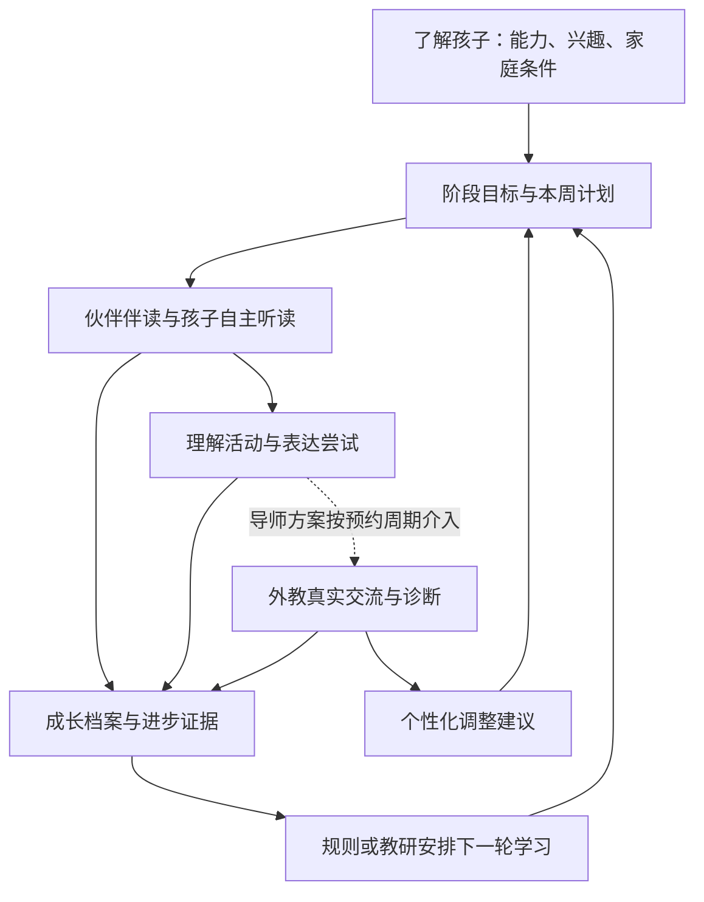

# 英语启蒙产品架构与关键模块讨论稿

版本：v0.6  
日期：2026-11-02  
状态：核心方向及八项选择已确认，详见第 12 节。用户已明确先实现低保真可交互流程，不再以高清视觉选择为本轮编码前置；首日流程版已实现并通过主线检查，位于同目录 first-day-demo/。角色与最终视觉仍待后续确定。

## 1. 已确认的产品定位

| 项目 | 已确认内容 |
| --- | --- |
| 目标用户 | 首版同时覆盖 3–8 岁儿童及其家庭，按年龄与能力适配 |
| 学习范围 | 听说、绘本听读与故事理解优先；系统拼读课程后续加入 |
| 日常学习主线 | 孩子自主听读、互动与表达为主，亲子共读和生活延伸可选 |
| 高端外教的作用 | 稳定导师、固定周期一对一，提供交流、诊断和个性化指导 |
| 当前讨论重点 | 产品架构、学习体系、核心体验、功能关系 |
| 核心体验方向 | 孩子与伙伴共同探索故事世界，以故事任务串联学习 |
| 内容入口关系 | 主线故事任务 + 自由书架，保留孩子自由选书与重读的入口 |
| 主要使用设备 | 儿童端平板为主，手机兼容阅读与家长管理 |
| 内容路线 | 自有伙伴世界、少量原创样板，后续接入精选授权绘本 |
| 伙伴智能 | 任务内互动，可在产生重要体验或价值的环节接入大语言模型 |
| 付费结构 | 免费完整样板 + 家庭内容订阅 + 可加购的导师周期服务包 |

一句话定位：让 3–8 岁孩子与伙伴自主探索故事、听读与表达，并可由稳定外教持续指导的英语成长产品。

产品需要同时回答三件事：孩子今天愿意做什么；家庭怎样持续执行；家长如何知道孩子正在进步。

### 1.1 本轮确认与细化边界

- **已确认 D01**：采用“孩子与伙伴共同探索故事世界”的主体验。
- **已确认 D02**：首页由伙伴发起故事任务，自由书架作为并行入口。
- **已确认 D03–D10**：用户选择依次为 1.C、2.C、3.A、4.A、5.A、6.A（关键价值处可接入大语言模型）、7.A、8.A，完整记录见第 12 节。
- **本轮细化**：多年龄适配、自主引导与困难恢复、任务内智能互动、可追溯证据。
- **仍待确定**：主伙伴正式形象、具体书目、外教频次与时长、收费价格。下文具体界面名称与流程是落实方向的设计方案，尚待使用验证。
- **最新视觉反馈**：原三版背景与场景细节过多，缺少清楚的 App 首页层级；原第 3 张仅为相对偏好，不是已选视觉目标。用户已提供 Buddy 首页与路径实机截图。新方案见同目录《海外学习App首页调研与方案建议.md》。
- **本轮实施决定 D11**：用户要求先交付低保真、可交互的首日流程，授权直接完成本地实现、必要检查与迭代；A/B 视觉图不作为本轮实现的选定目标。可体验版本见 first-day-demo/README.md。

“自主完成为主”指日常学习的说明、带读、帮助和衔接主要由产品提供。家长负责初次设置、设备准备、必要协助和回顾安排；不同孩子实际需要的帮助通过试用观察，不预设每位低龄孩子都能全程无需成人协助。

## 2. 构思产品框架的顺序

建议依次确定：

1. **成长目标**：希望孩子获得哪些可观察的能力。
2. **学习单元**：一次完整体验如何产生理解、表达与观察机会。
3. **跨次学习闭环**：家庭听读、外教指导、后续计划如何衔接。
4. **角色关系与持续使用**：孩子为什么愿意回来，家长怎样维持节奏。
5. **页面与导航**：为前面的行为配置入口、状态与反馈。
6. **进步证据与付费权益**：家长能看见什么，哪些持续服务值得付费。

先形成一个可走通的学习单元，再决定首页展示什么。页面应服务于明确的行为，避免先堆出大量入口。

## 3. 整体产品架构

### 3.1 学习闭环

家庭日常学习本身形成“体验—证据—下一步”的闭环，不以购买或完成外教交流作为单元结束条件。导师方案在此基础上增加“真实交流—诊断—个性化调整”的闭环，按约定周期介入。

### 3.2 四个使用角色

| 角色 | 核心需要 | 对应产品能力 |
| --- | --- | --- |
| 孩子 | 有趣、能理解、有选择、有人回应 | 听读、互动、表达、伙伴陪伴 |
| 家长 | 设置容易、了解使用情况、看懂进步与后续安排 | 档案与使用设置、证据回顾、预约、导师沟通、可选共读提示 |
| 外教 | 了解孩子、针对性交流、持续跟进 | 课前简报、任务准备、观察记录、计划建议 |
| 教研运营 | 内容与教学质量可持续 | 能力地图、单元编排、内容管理、教师培训与质量检查 |

四个角色共用三个基础对象：**学习目标、学习单元、孩子成长档案**。

自主学习增加一项贯穿各页面的基础能力：语音说明、动作示范、分层帮助、暂停恢复和结束引导。它必须覆盖整个活动流程。

### 3.3 世界、绘本与学习目标的关系

主伙伴拥有持续的日常生活与探索经历，绘本是它与孩子共同发现的故事。主伙伴在读书前邀请、读书后延伸，在获得授权的范围内与内容互动；各绘本保留自己的故事、角色和风格。

同一个语言目标可以出现在多本书、多次活动和外教交流中。统一的伙伴世界提供连续感，书籍提供丰富的内容，能力地图负责教学上的连续性。

| 孩子看到的层级 | 对应内容 | 家长与教研看到的对应关系 |
| --- | --- | --- |
| 伙伴的世界 | 日常场景、故事经历、共同作品 | 长期参与与阶段回顾 |
| 一次主题探索 | 例如“准备野餐” | 一组相关学习目标与适合的材料 |
| 一个学习单元 | 读故事、做任务、留下作品 | 输入、理解、表达、观察与延伸 |
| 一次小活动 | 听故事、找物品、回应伙伴 | 具体目标、支持条件和表现记录 |

## 4. 学习体系：年龄与能力分别处理

### 4.1 三条能力线

| 能力线 | 主要观察 | 典型活动 |
| --- | --- | --- |
| 听懂 | 理解词语、指令、问句与故事情节 | 听音找图、动作回应、故事排序 |
| 表达 | 回应、提问、描述、讲述 | 选择后表达、角色扮演、与老师交流 |
| 绘本与阅读 | 首版观察故事理解与文字相关表现；后续发展解码与独立阅读理解 | 伙伴伴读、听读后理解活动；亲子共读可选，系统拼读后续加入 |

孩子可以听力领先、表达较慢，也可以熟悉某本书但尚不能独立阅读新文字。成长档案需要分别记录这些表现。

### 4.2 建议采用的阶段划分

以下是产品设计草案，不是年龄标准或学习效果承诺。

| 阶段 | 学习重心 | 交互特点 |
| --- | --- | --- |
| 启蒙参与 | 愿意听、能参与、建立声音与情境联系 | 语音与动作示范、指认和选择；允许暂不说话，成人可按需协助 |
| 听说发展 | 理解常见问句，参与简单交流 | 重复句式、角色游戏、逐渐减少提示 |
| 故事理解与表达 | 理解更完整的情节、问答、描述与讲述，观察文字兴趣 | 听读、排序、描述与讲述；系统拼读与独立阅读路径放后续阶段 |

年龄影响故事题材与操作方式；能力影响语言目标、内容难度和支持程度。阶段安排可以根据新的观察调整，不能只按年龄指定英语水平。

### 4.3 绘本内容的组织

- **故事绘本**：服务兴趣、理解、想象与交流。
- **分级读物**：为逐步发展的阅读能力提供有序内容。
- **与拼读进度匹配的可解码读物**：支持特定文字解码练习。

三类内容分别标注语言难度、理解负担、文字解码要求和适用活动，不直接混成一个等级。首版以故事绘本与适配的分级内容为主，可解码读物与系统拼读进阶在后续教学阶段建设。

### 4.4 覆盖 3–8 岁的共同框架与差异化版本

首版保留统一世界、角色和单元结构，为同一主题配置不同支持与表达要求。以下分组仅为交互设计的工作方案，需在各组实际试用。

| 年龄适配组 | 交互适配方向 | 相同主题中的活动例子 |
| --- | --- | --- |
| 3–4 岁 | 语音优先、少量大目标、单步动作示范、容易重听与退出 | 听到食物名称后指认或点击，选择自己想带的东西 |
| 5–6 岁 | 单步到短序列任务、更多选择，尝试简单回应 | 按请求装篮子，说词或短句回应 |
| 7–8 岁 | 适龄题材、较完整的任务与表达空间，保留语音帮助 | 讨论野餐安排、描述选择或讲述经过 |

这些例子不是年龄能力标准。各年龄组内仍按听懂、表达、故事理解和操作表现选配难度；年长初学者也可以获得基础支持，年幼孩子的进阶表现同样可以被记录。

## 5. 关键页面与功能关系

### 5.1 儿童首页：帮助孩子开始今天的一次体验

首页优先回答：“谁在等我一起玩？今天做什么？从哪里继续？”

首页必须明确主要可操作对象与第一行动。伙伴、当前任务、导航与背景在视觉上分层；场景细节集中到需要它的学习活动。具体采用“伙伴 + 今日任务”“伙伴大厅”还是“路径首页”待本轮结构选择，下表与信息顺序为工作草案。

| 页面区域 | 内容 | 主要行为 |
| --- | --- | --- |
| 伙伴开场 | 与上次经历或本周故事有关的一句话 | 建立连续感，语音可重播 |
| 今日主任务 | 一项明确活动，例如“帮伙伴找到走丢的小狗” | 开始或继续，作为最突出的按钮 |
| 最近阅读 | 上次的书、页码或熟悉的收藏 | 直接继续或重读 |
| 下一次期待 | 本周故事后续、已安排的外教交流 | 知道下一次有什么值得期待 |
| 家长入口 | 计划、预约、报告与会员 | 经家长验证后切换 |

本轮建议儿童端采用三个主入口：“今天 / 书架 / 旅行册”，名称暂定。主伙伴贯穿首页、活动和作品回顾；共同经历优先沉淀在旅行册中。

“今天”负责开始与继续；“书架”负责自由选择与重读；“旅行册”负责回看共同经历。探索地图从今天的主题卡进入，外教交流从预约卡进入。家长中心为独立入口。

首页需要覆盖：首次进入、进行一半、今日完成、多日未使用、暂无安排五种状态。再次回来时，优先提供熟悉而容易开始的活动。

#### 首页的具体信息顺序

1. **伙伴与当前场景**：例如伙伴正在收拾野餐篮；开场语音可重播。
2. **唯一突出的主行动**：首次为“一起准备野餐”，中途为“继续打包食物”。
3. **本次选择**：主任务之外，保留“读一本喜欢的书”。
4. **共同经历入口**：小幅展示最近生成的野餐旅行页，可以回看。
5. **已预约的老师**：有预约时显示老师和交流主题，由家长管理时间与安排。

孩子完成本次安排后，首页转为“今天一起完成了什么”，允许自然结束，也可自由重读。首次使用时由家长完成必要设置，孩子尽快进入一个可理解的小任务。

首次进入的儿童引导嵌入真实活动：伙伴用语音和动作示范开始、重听、选择、求助与退出。儿童主流程不要求识字、输入文字或阅读操作说明；帮助入口始终可识别。

### 5.2 核心学习路径页：让孩子知道下一步，让家长理解安排

教学结构采用：**能力阶段 → 主题 → 学习单元 → 当前活动**。儿童的路径页将它呈现为可理解的探索路线，不直接展示抽象能力分数。

儿童看到具体故事、地点与任务；家长可以展开查看对应的学习目标、内容难度和安排原因。

必要内容包括：当前位置、本周主题、正在进行的单元、下一活动、可复读内容、阶段回顾入口。

区分三个状态：

- **活动完成**：已经经历过一次。
- **当前能力表现**：系统或老师观察到什么。
- **内容可访问**：是否符合当前计划和订阅权益。

一次活动完成不直接代表能力掌握。付费可访问也不代表适合立即进入该难度。

#### 路径页的工作方案

以“准备野餐”为例，显示当前主题、伙伴所在位置，以及“读故事 → 装篮子 → 表达选择 → 留下旅行页”的活动节点。多次进入时从当前位置继续，已体验内容可以重读重玩。

节点使用“可以开始 / 进行中 / 已体验 / 稍后安排”等活动状态。下一活动优先根据适配的计划开放，不要求孩子把所有语言目标答对后才继续故事。

如果孩子从自由书架阅读了与主线相同的绘本，路径可同步标注“已读过”；相关理解或表达活动仍按实际完成情况记录。

### 5.3 书架与绘本详情页

书架包含“本周阅读”“我喜欢的”“最近读过”“自由探索”。路径提供方向，书架保留孩子的自主选择。

详情页包含：故事简介、封面与试听、听读方式、继续阅读位置、可选择的相关活动。孩子可直接开始伙伴伴读；需要额外成人协助的特殊材料在家长侧说明。

阅读器支持完整听读、逐页阅读、暂停复听和语音操作说明；必要的理解帮助由伙伴提供。亲子提示作为成人可查看的可选支持。故事中的互动应可跳过或稍后再做，保持完整欣赏故事的体验。

### 5.4 外教交流入口

孩子侧显示熟悉的老师、这次要聊的故事或任务、进入交流的清晰入口。

家长侧负责预约与调整安排、设备准备、查看反馈和服务权益。课前简报应自动汇集已读内容和近期表现，并允许家长补充在家的观察。

### 5.5 旅行册：伙伴关系与作品积累的入口

旅行册以主题页收集共同经历。每页包含故事场景、孩子选择过的物品、参与方式，以及家长允许保存的作品。

例如野餐页显示孩子装进篮子的食物，可以再次听到伙伴的回应，也可以重看孩子自愿保留的表达。孩子不录音时，页面仍可以由其选择和共同场景组成。

旅行册用于孩子回顾与讲述；同一经历的学习证据在家长中心显示任务条件与判断。两种展示共用记录，但内容深度不同。

## 6. 一个内容学习单元应该包括什么

### 6.1 单元的基本结构

**一个具体情境 + 少量语言目标 + 核心故事 + 多种参与方式 + 后续使用机会。**

单元可跨多次家庭活动完成，时长随内容、能力、家庭安排调整。每次进入都可以从明确的小任务开始。

| 组成部分 | 必须交代的内容 | 孩子侧体验 |
| --- | --- | --- |
| 学习目标 | 想观察哪项理解或表达能力 | 目标转化为故事任务 |
| 情境开场 | 角色、问题、孩子参与的理由 | 伙伴邀请或故事事件 |
| 核心输入 | 绘本、音频、情境语言及重复机会 | 伙伴伴读、自主听读，可选亲子共读 |
| 理解活动 | 如何通过动作或选择观察理解 | 找图、排序、递物、动作回应 |
| 表达机会 | 可接受的回应，以及不同层次的帮助 | 指认、说词、说句子、角色交流 |
| 支持与反馈 | 怎样鼓励、重听、示范、降低难度 | 得到具体回应，可以再试 |
| 生活延伸 | 如何在屏幕之外使用相同语言 | 亲子小游戏、实物活动、实体书共读 |
| 外教连接 | 老师可以用什么新情境观察和延伸 | 与老师交流或共同完成任务 |
| 成长记录 | 记录什么证据、支持程度和情境 | 作品或经历进入成长档案 |
| 后续安排 | 重读、再观察或进入下一目标的依据 | 收尾、选择与下次期待 |

首版默认由产品完成带读与活动引导；成人共读与生活延伸为可选参与，不作为进入下一活动、形成反馈卡或结束单元的必要条件。

理解活动和表达活动允许采用替代路径。暂未开口、识别失败、未完成，都要保留具体原因，不统一标成“不会”。

### 6.2 样板单元：帮伙伴准备野餐

以下角色与故事均为占位设定，未确认正式形象、书目或素材授权。

- **情境**：伙伴准备野餐，需要孩子帮忙选择和打包食物。
- **主要目标**：理解本单元选定的食物词；根据能力回应偏好或提出简单请求。
- **核心绘本**：一本围绕野餐与选择的短故事，可反复听读。
- **理解活动**：听到物品名称后选择相应图片或实物。
- **表达活动**：从指认开始，逐步尝试“Apple”“An apple, please”或表达偏好，任务按孩子阶段配置。
- **反馈**：伙伴根据孩子的选择改变野餐篮里的东西，语言带来可见结果。
- **家庭延伸**：家长在真实点心时间提供两种选择，观察孩子如何回应。
- **外教交流**：老师带来新的野餐安排，观察孩子在变化后的情境中如何理解和表达。
- **证据**：分别保留独立完成、提示后完成、模仿完成与尚未观察到的情况。
- **后续**：重读喜欢的部分，或将同类表达放进新的生活情境。

家长手工记录的生活活动标注为“家长观察”；播放完成标注为“使用记录”。两者都不自动认定独立能力。

### 6.3 样板单元逐步流程

以下按一个单元中的活动顺序说明，可分多次完成。正式用语、目标词与难度需教研确定。

| 步骤 | 孩子经历什么 | 伙伴怎样回应 | 记录什么 |
| --- | --- | --- | --- |
| 1. 接到邀请 | 伙伴拿着篮子邀请一起准备野餐 | 说明一个容易理解的目标，让孩子决定开始 | 是否参与及开始位置 |
| 2. 一起读故事 | 跟随音频与伙伴听读一本相关绘本，可暂停重听；亲子共读可选 | 阅读前后衔接情境；完整阅读时不强制插题 | 接触材料、阅读方式与进度 |
| 3. 帮忙装篮子 | 听到食物名称后，在图片或实物中选择 | 篮子随选择变化；需要时重听、缩小选项或示范 | 选项、指令、提示程度与回应 |
| 4. 说说想带什么 | 在选择情境中回应，可指认、说词或尝试短句 | 对选择作有意义的回应；孩子愿意时提供表达示范 | 自发表达、提示后表达、模仿或非口语回应分别记录 |
| 5. 野餐出发 | 看见自己参与准备的野餐场景 | 回顾共同完成的事，生成旅行页 | 共同作品及孩子选择 |
| 6. 在家再用一次 | 家长可在真实点心时间延伸 | 成人提示页给出简单做法 | 家长自愿提供的生活观察，注明来源 |
| 7. 后续再观察 | 下一次在变化后的图片或情境中回应 | 引入相关新经历；导师方案也可在交流中延伸 | 是否在不同材料或情境中仍能理解、表达 |

不同能力的孩子可以经历相同主题，但回应要求不同：指认与动作、简单词语、短句或描述。首版记录自然出现的文字相关表现，不把系统文字解码训练设为所有孩子完成单元的必经活动。

### 6.4 暂停、困难与恢复

- **暂不说话**：允许选择或动作参与；本次不产生独立口语能力结论。
- **语音识别不确定**：允许重听、再试或继续；记录不确定性，必要时供老师复核。
- **理解困难**：按预设层次提供重听、图片支持、缩小选项或示范，保留帮助程度。
- **中途离开**：保存位置与已完成活动，返回时给出简短回顾。
- **只想读书**：允许完成阅读后结束，互动可以留到以后。

帮助按“重听 → 图片或动作示范 → 减少选项或拆小步骤 → 示例回应”逐层提供，实际支持写入记录。持续困难时，孩子可换熟悉内容、稍后继续或找家长，保存位置后自然退出；普通活动无需等待家长讲解才能继续。

### 6.5 单元结束时的三种产物

| 面向谁 | 产物 | 作用 |
| --- | --- | --- |
| 孩子 | 一张共同旅行页，含选择与作品 | 有可回看的共同经历 |
| 家长 | 本次表现卡与一个家庭延伸建议 | 看懂孩子在具体条件下做到了什么 |
| 外教与教研 | 目标、材料、支持程度和观察摘要 | 决定后续观察重点与调整方式 |

故事结束可以表现为任务完成；能力记录根据证据单独更新。孩子即使尚未独立表达，也能经历完整故事。

## 7. 持续使用与伙伴关系

### 7.1 三个持续使用的理由

| 对象 | 愿意回来的理由 | 产品如何回应 |
| --- | --- | --- |
| 孩子 | 喜欢角色和故事，能做成事情，想知道后续 | 连续情境、具体反馈、自主选择、作品积累 |
| 家长 | 设置与安排容易，能看懂收益 | 自主引导、清晰计划、真实进步证据、可选共读提示 |
| 家庭整体 | 有稳定节奏，老师持续了解孩子 | 灵活安排、容易恢复、导师跟进 |

需要验证的假设：角色关系和连续故事能提高孩子主动参与；减少家庭安排负担能帮助持续执行；具体证据能增强家长对长期服务的理解。

### 7.2 主要角色的分工

建议先采用“一位稳定主伙伴 + 单元中的故事角色 + 真人导师”。

- **主伙伴**：与孩子共同经历故事、接续上次活动、回应孩子的选择。
- **故事角色**：带来不同事件和交流情境。
- **真人导师**：理解孩子、提供真实交流、诊断和指导。

主伙伴可以表现出好奇、会求助、愿意尝试，也让孩子有帮助它的机会。关系建立在共同经历中。

### 7.3 让伙伴关系实际发生

| 关系机制 | 示例 | 所需支持 |
| --- | --- | --- |
| 记得共同经历 | “上次你帮我找到了苹果，今天我们带什么？” | 经家长允许保留的活动记录 |
| 回应孩子选择 | 孩子选了狗，后续故事出现相关分支 | 少量可控的情境分支 |
| 共同完成事情 | 一起准备野餐、布置房间、帮助故事角色 | 与语言目标关联的任务 |
| 保存共同作品 | 将孩子的描述、画或故事放进旅行册 | 作品收藏与回看 |
| 接续下次经历 | “下次我们去看看篮子里的种子长什么样。” | 内容之间有合理连续性 |

首版通过任务分支、共同经历记录和适配回应建立连续感。用户已允许在重要体验与价值环节接入大语言模型，具体范围见第 7.6 节；儿童主入口仍围绕故事任务组织。

### 7.4 日常与长期的节奏

- **一次活动**：期待 → 参与 → 得到回应 → 留下作品或进展 → 自然收尾。
- **一周**：围绕一个主题多次接触，保留孩子想重读的内容，完成一次回顾或交流。
- **一个阶段**：回看作品和能力变化，开启新的故事与目标。

家庭可以选择学习日、调整计划、暂停与恢复。中断后从熟悉活动继续；伙伴欢迎孩子回来，关系保持稳定。

奖励优先采用完成的故事、收藏的作品、共同创造的场景和具体表扬。伙伴的关心和基本关系不随连续登录、购买等级变化，也不通过角色受苦、失去友情等情节催促孩子使用或购买。

验证持续使用时，同时看孩子主动重读或发起参与、家庭计划能否执行、中断后能否顺利恢复，以及参与是否伴随理解或表达的新证据。使用时长只描述使用，不单独代表学习价值。

### 7.5 首版伙伴能力的具体范围

首版先让伙伴可靠地做到三件事：接续上次活动、回应孩子本次选择、与孩子回看共同作品。

| 场景 | 可用的具体信息 | 示例行为 |
| --- | --- | --- |
| 再次进入 | 上次单元和进行位置 | “篮子还没装完，我们继续吗？” |
| 重读喜欢的书 | 孩子主动收藏或选择的书 | 邀请重读相应故事，不将一次选择扩展成人格判断 |
| 本次活动收尾 | 这次真实发生的参与和选择 | 回顾“你把香蕉放进篮子里了”，而不是空泛夸奖 |
| 多日未使用 | 最近的熟悉内容与保存位置 | 欢迎回来，提供熟悉任务和重读选择 |

对照这些场景验证：孩子能否感到经历被接续，愿不愿意主动回看或讲述。角色形象与世界美术在结构明确后另行选定。

### 7.6 大语言模型的产品作用

大语言模型优先服务“孩子以不同方式回应，伙伴仍能理解并给出有意义的反馈”，也可用于帮助与摘要。是否采用以样板中可观察的体验增益决定，不要求所有活动都实时生成。

| 场景 | 可提供的价值 | 输入与输出范围 | 不确定或不可用时 |
| --- | --- | --- | --- |
| 任务内自然回应 | 接受不同说法和中英混合，保持交流连续 | 当前任务、场景物品、孩子回应与不确定信息；输出意图候选、简短回应与允许的场景动作 | 请孩子确认，或转为点击选择；未确认不判不会 |
| 困难时的帮助 | 根据已有回应与帮助历史，提供更容易理解的下一步 | 仅在教研设定的帮助层级内选择或组织解释；记录实际支持 | 使用已审核的固定语音、动作示范与选择活动 |
| 接续共同经历 | 让邀请与回顾更贴合真实经历 | 只引用获准保存的具体活动、选择和作品，生成一句相关接续话语 | 使用当前场景开场，不编造历史 |
| 家长与外教摘要 | 将分散记录整理为可读反馈与课前简报 | 每条描述关联实际任务、材料、支持条件与观察来源；提供可复核草稿 | 使用结构化模板显示已有记录 |

语音识别负责尝试确认孩子说了什么，模型负责解释意图与组织回应，能力状态依据证据和教学规则更新。一次模型理解正确或一次对话顺利，不直接成为“已掌握”。中文回应可以推进故事任务，但不据此记为英文表达；模仿、提示后表达与无额外语言提示的表达分开记录。

模型只调用当前任务允许的场景动作，使用经过限定的目标、语言范围与记忆信息。伙伴回应需要适配年龄和能力；具体响应速度、稳定性与每次体验成本，在样板阶段比较后确定。模型服务不可用时，完整任务仍有预设回应和选择路径。

首条优先验证的智能闭环：**伙伴提问 → 孩子自然回应 → 语音与意图理解 → 伙伴回应并改变场景 → 有歧义时确认或改用选择 → 记录支持条件 → 生成可追溯的反馈。**

## 8. 给家长看的进步证据

### 8.1 区分三类信息

| 类型 | 例子 | 能说明什么 |
| --- | --- | --- |
| 使用记录 | 听读次数、阅读时长、完成活动 | 接触和参与情况 |
| 作品记录 | 一段表达、故事排序、一次任务过程 | 在具体条件下完成了什么 |
| 能力观察 | 无提示理解问句；换情境后仍能回应 | 带情境和支持条件的能力表现 |

三类信息可以关联查看，但报告中的能力判断要能找到对应观察依据。

### 8.2 一张进步证据卡

> **这周观察到：能更独立地回答偏好问题。**  
> 上次：在相近难度活动中，需要老师先示范，才能回应喜欢哪种食物。  
> 这次：在新的点心情境中，没有口头示范，能回应自己的选择。  
> 证据：两次任务片段，附日期、情境、提示情况与观察者。  
> 当前判断：在这些熟悉话题中表现更独立；其他话题仍需继续观察。  
> 在家可以做：提供两种真实点心，留出等待时间，观察孩子怎样回应。

以上是报告格式示例，不是真实学习结果。比较时要记录任务难度、图片支持、语音、提示等条件；条件明显不同时，只呈现两次表现，不直接宣称提升幅度。

### 8.3 家长页面的三层展示

1. **本次反馈**：参与了什么、具体表现、下一次可以怎样支持。
2. **本周回顾**：少量最有解释力的新证据、一项继续观察的能力、一项家庭行动。
3. **阶段档案**：听、说、读分别回看，关联历史作品、外教观察与计划调整。

使用“尚未观察到”“需要提示”“已多次独立完成”等带依据的描述。证据不足时明确显示；外教或教研可以复核。熟悉材料表现与新情境表现分别记录，不因一次完成永久判定掌握。

家长能查看语音和作品保存情况，决定是否保留、分享或删除；分享由家长发起。

自主操作与语言表现分别记录。孩子自己完成操作，如果依靠了语义提示或示范，语言表现仍按对应支持条件描述。成人协助可由当次选择或家长补充注明，不能从“未记录成人协助”直接推断完全无人帮助。

家长日常看报告不需要先手工上传观察。系统根据活动记录生成基础反馈；家长补充生活观察、导师解释与复核都作为额外来源。

### 8.4 野餐单元如何变成家长可见的证据

一张本次反馈卡可以这样呈现，以下为格式示例：

> **今天一起完成：准备野餐。**  
> 听懂：在三张食物图片中，听到“banana”后独立选择了香蕉；记录当时的指令与选项。  
> 表达：在示范后尝试了“Apple, please”；本次标注为模仿表达。  
> 阅读：已在伙伴与音频引导下听读这本故事；本次没有观察文字解码能力。  
> 下一步：换一次图片位置和材料，再观察是否仍能听懂；在点心时间给孩子选择机会。  
> 查看依据：活动过程摘要、帮助情况，以及经允许保存的作品。

有可比的历史观察后，再形成“比之前更独立”的比较。只有本次证据时，展示本次具体表现。

## 9. 付费权益与付费墙

### 9.1 权益按完整价值链分层

“免费完整样板 + 家庭内容订阅 + 导师周期服务包”的组合已确认。下表细化权益；价格、数量、有效期、续费与退改安排仍待确定。

| 权益 | 免费体验 | 家庭成长会员 | 导师指导方案 |
| --- | --- | --- | --- |
| 完整样板学习单元 | 包含 | 包含 | 包含 |
| 持续的主题学习路径 | 样板范围 | 会员内容范围内提供 | 包含，并有导师调整 |
| 绘本与听读内容 | 体验书架 | 会员授权书架 | 同家庭成长会员 |
| 理解与表达活动 | 样板范围完整体验 | 会员单元内提供 | 同家庭成长会员 |
| 主伙伴与基本关系 | 包含 | 包含 | 包含 |
| 已产生的基础学习记录与证据 | 可查看 | 可查看 | 可查看 |
| 持续计划、周期回顾与家长支持 | 样板回顾 | 持续提供 | 加入导师解释和个性化指导 |
| 智能伙伴与任务帮助 | 样板范围内完整体验 | 会员内容内提供相应体验 | 同家庭会员，另含真人指导 |
| 真人外教交流与诊断 | 体验形式待定 | 不含常规真人服务 | 约定频次或次数 |
| 导师个性化计划与家长答疑 | 不含常规服务 | 不含常规服务 | 明确频次、时限和额度 |

权益划分的重点：免费体验让家庭走通一次完整的家庭学习闭环；家庭会员提供持续内容与安排；导师方案增加持续的人类判断、交流和个性化服务。真人体验如有提供，按单独说明的权益安排。

已有基础学习记录和已生成证据到期后仍可查看。订阅内容按授权有效期访问；持续计划更新、后续回顾和真人服务按有效权益提供。若以后增加单独永久购买内容，再另行定义规则。

导师包作为家庭内容订阅之上的周期服务，可与内容合并购买为高阶方案。付费墙分别说明内容有效期和真人服务次数，实际计费与到期规则仍待确定。大语言模型暂作为相应任务体验的实现能力，不单独推出面向孩子的聊天次数付费层级。

### 9.2 付费墙出现的位置

建议只向家长展示购买决策：

- 完成样板单元并看过回顾后，选择下一阶段计划。
- 家长主动查看会员书架或后续主题时。
- 家长希望预约外教、获得个性化指导时。

孩子在进行中的故事内不遇到支付流程；开始前完成权益检查。儿童侧遇到需要家长安排的内容时，提供中性说明与可继续的活动。

免费样板拥有完整结尾与旅行页。下一阶段的购买选择在家长侧发生；主伙伴继续陪伴孩子阅读可访问的内容，已有作品可以回看。

付费墙展示：孩子当前阶段、下一阶段包含的内容、权益差异、完整价格和计费周期、真人服务边界、取消及到期影响。不能把未来学习成果作为保证。

### 9.3 家长侧文案示例

> **继续接下来的主题学习**  
> 你们已体验“野餐”单元。后续计划会在新故事中继续练习理解与表达。  
> 家庭成长会员：持续的听读内容、学习安排和周期回顾。  
> 导师指导方案：在家庭会员基础上，增加约定的真人交流、诊断与个性化建议。  
> 查看各方案的内容范围、服务次数、价格与有效期后再选择。

具体书目、计划与服务数量确认后，文案需要替换为真实权益。收费页面中的进步示例应有来源或明确标为示例。

## 10. 高端外教服务的产品化

已确认稳定导师、固定周期一对一。围绕导师关系建立三个环节：

| 环节 | 输入 | 应交付的结果 |
| --- | --- | --- |
| 交流前 | 最近读过的书、活动表现、上次观察、家长补充 | 本次重点与适合孩子的交流任务 |
| 交流中 | 孩子的真实回应 | 对理解、表达、兴趣、支持需求的具体观察 |
| 交流后 | 本次新增证据 | 下一阶段选书、活动建议、家庭指导 |

导师可以在教研设定的目标和内容范围内调整。产品记录调整了什么、为什么调整、下次观察什么，保证家庭能理解并执行。

高端服务需要后续明确：匹配与更换方式、交流频次与时长、备课与反馈时限、答疑边界、取消改约与未使用服务的处理。费用设计应与实际教师和教研投入相匹配。

## 11. 第一版范围与验证方式

### 11.1 建议先完成一个完整主题周期

围绕一个主伙伴、一个包含少量原创样板的主题周期，分别配置适合 3–8 岁各交互年龄组和不同英语起点的版本，打通：

**建立儿童档案 → 选择家庭安排 → 完成听读与活动 → 留下旅行页和证据回顾 → 安排下一轮计划 → 家长选择后续服务。**

导师方案在这个基础上补充验证：外教能否读懂家庭观察、组织有针对性的交流，并给出可执行的调整建议。

首版同时覆盖 3–8 岁，不再以单一年龄段作为首批范围。样板试用覆盖 3–4、5–6、7–8 岁的操作差异和各组内的不同英语起点；内容数量可以先少，年龄与能力适配不能省略。

### 11.2 首版必要模块

| 优先级 | 模块 | 验证目标 |
| --- | --- | --- |
| P0 | 家长设置、儿童档案、初步了解能力 | 能安排适合的起点 |
| P0 | 儿童首页、路径入口、绘本听读 | 孩子与家庭知道从哪里开始、如何继续 |
| P0 | 多年龄适配、语音与动作引导、分层帮助和暂停恢复 | 各组孩子能开始、理解下一步、求助、继续和收尾 |
| P0 | 完整学习单元、轻量伙伴互动与旅行页 | 故事有完整结果，经历可接续，也能形成学习观察 |
| P0 | 家长反馈与证据卡 | 家长能理解具体表现与下一步 |
| P0 | 外教准备、交流、反馈与计划调整 | 真人服务能使用家庭信息并改变后续安排 |
| P0 | 真实权益说明、家长付费入口 | 家长理解不同方案的价值与边界 |
| 样板优先验证 | 任务内自然回应的大语言模型能力 | 相比预设回应有明确增益，不确定时能确认并继续，记录可追溯 |
| P1 | 伙伴独立空间、更多故事分支 | 验证是否增加主动参与与连续感 |
| P1 | 更丰富的内容、自动安排与阶段档案 | 在已有闭环有效的基础上扩展 |

早期教研编排、外教简报和计划调整可由人工辅助完成。自动化程度随验证结果决定。

验收关注：各年龄组孩子能否自主开始、理解下一步、使用帮助、恢复与收尾；哪些位置仍必须成人解释；外教能否利用家庭信息；家长能否从证据理解下一步；付费权益能否清楚兑现。自主操作情况和语言学习表现分别观察，不将时长、故事完成或模型回答流畅度当成能力提升。

## 12. 产品决策记录与后续事项

### 12.1 已确认的方向

- D01：孩子与伙伴共同探索故事世界。
- D02：伙伴发起故事任务，自由书架作为并行入口。
- 家庭听读是主线；外教负责交流、诊断和个性化指导。

### 12.2 本轮已确认的八项选择

用户已逐项确认以下选择。它们是产品范围与体验决策，具体效果、交互和服务成本仍需通过样板验证。

| 编号 | 用户选择 | 已确认方案 | 对产品的影响 |
| --- | --- | --- | --- |
| D03 | 1.C | 首版同时覆盖 3–8 岁 | 统一世界与学习结构，按年龄和能力配置活动，并覆盖各组试用 |
| D04 | 2.C | 孩子独立完成为主 | 语音伴读、演示、帮助和恢复进入核心流程；家长负责设置与必要协助 |
| D05 | 3.A | 听说、绘本与故事理解优先，系统拼读后续加入 | 自主使用不等于已经能够独立阅读文字，首版目标与宣传分别说明 |
| D06 | 4.A | 儿童平板优先，手机兼容阅读与家长管理 | 儿童主体验按平板设计，具体客户端技术后定 |
| D07 | 5.A | 自有伙伴世界 + 少量原创样板 + 后续精选授权内容 | 先准备原创教研样板；绘本接入按实际授权与适配安排 |
| D08 | 6.A + 补充 | 任务内互动，重要体验与价值处允许接入大语言模型 | 优先验证自然回应、分层帮助、经历接续与可追溯摘要 |
| D09 | 7.A | 稳定导师、固定周期一对一，含课前准备与课后调整 | 建立连续服务流程；频次、时长与具体服务承诺后定 |
| D10 | 8.A | 免费完整样板 + 家庭内容订阅 + 导师周期服务包 | 保持完整体验和清楚的内容、真人服务边界 |

补充说明：

- D04 下的中文说明优先服务家长设置与回顾；孩子是否需要短母语提示，可按能力和理解情况配置。首发销售地区未预设。
- D07 如果已有可使用的完整书目或授权合作，应按实际资源调整启动顺序。这里只建议路线，不假定资源已经取得。
- D08 已明确允许大语言模型用于重要体验，不要求所有活动使用。具体模型、语音方案和记忆实现，按体验、质量、响应与成本验证后选择。
- D10 推荐导师包与有效家庭会员配套使用，也可合并购买为高阶方案。取消或到期后的内容访问、已购服务和记录保留要分别说明，具体规则仍待成本与交付条件确定。

### 12.3 可以继续由产品与实施细化的事项

上述方向已经确认，可以继续完善首页信息顺序、路径节点状态、单元暂停与恢复、提示层次、旅行页内容、证据卡字段。它们按照已确认目标细化，不需要逐个按钮交给负责人决定。

默认按主题分多次完成，家庭自选学习日、可以重读和顺延。每次进入提供明确的小目标和自然结束点；具体单次时长、观察次数和更新标准通过样板试用与教研验证。

### 12.4 后续再决策与需要补充的条件

- **视觉探索时**：角色正式形象、名称、世界场景、画风与页面视觉方向。
- **内容与试教成本清楚后**：确切价格、课时频次与时长、答疑额度、取消改约规则。
- **实施与上线前**：客户端技术、销售地区与相应交付范围、正式书目与授权范围。
- **需要补充的实际条件**：现有团队、阶段预算、可用内容与外教资源。这些信息会影响首版规模和服务承诺，不在本文中假定已有。

下一步形成首页、探索路径、学习单元、家长证据与权益页面的结构与流程说明；角色与视觉方案单独评审。具体页面结构详见同目录《核心页面与自主学习流程.md》。

## 13. 参考依据与方案边界

- [Cambridge English：Pre A1 Starters](https://www.cambridgeenglish.org/exams-and-tests/qualifications/young-learners/paper/starters/)：参考其用具体行为描述理解、表达与故事能力的方式，不将考试等级直接对应年龄，也不将考试课程作为产品默认主线。
- [British Council：Learning English through sharing picture books](https://learnenglishkids.britishcouncil.org/sites/kids/files/attachment/parents-articles-learning-english-through-picture-books-english.pdf)：参考亲子互动、重复阅读和按孩子需要调整共读方式的建议。该资料为较早发布的共读指南。

已确认方向见第 1 节。页面细节、伙伴机制、权益方案和商业价值仍为本项目的设计提案与待验证假设。文中样例不是真实用户数据，不包含确定价格、学习时长标准或学习效果保证。
