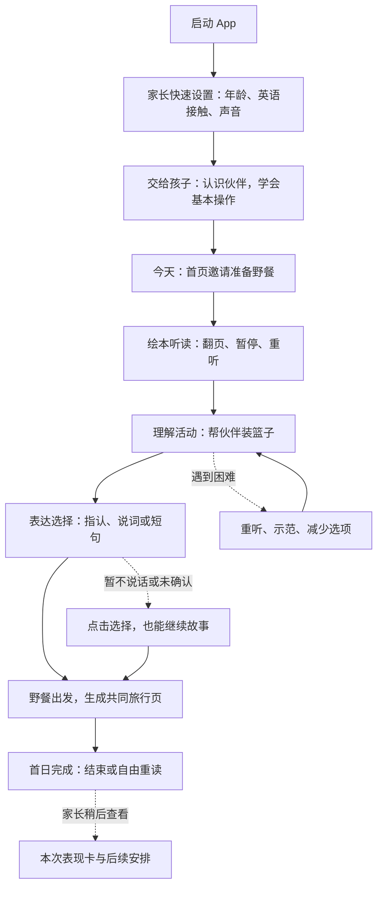

# 首日学习路径与可交互 Demo 范围

版本：v0.3  
日期：2026-11-02  
状态：用户已明确先交付低保真可交互流程；本地体验版已实现并检查，见同目录 first-day-demo/README.md。高清视觉、角色与后续真实服务接入仍未定稿。

## 1. 是否还有阻塞流程的产品问题

现有定位、年龄覆盖、自主学习、设备、内容、伙伴、外教和付费结构足以确定首日流程，不需要重复讨论。

原三版及后续 A/B 视觉图均未选定。用户已明确本轮先 Coding 低保真流程，因此高清视觉选择不再阻塞实现。当前采用简洁界面与基础图标，工作伙伴名 Milo，音频为系统语音合成；这些均不代表最终品牌、美术或配音。

## 2. 首日学习主线

**首日完成以儿童收尾页为准。** 查看家长报告、购买、预约导师都在可选分支中，不阻塞完成。

## 3. 每个步骤要做到什么

| 步骤 | 需要的内容与行为 | 完成或继续条件 |
| --- | --- | --- |
| 家长快速设置 | 年龄、英语接触、音量测试、语音权限说明；可以跳过录音 | 获得初步适配信息，进入儿童模式；无需先付费或注册账号 |
| 认识伙伴与基本操作 | 在真实小任务里示范开始、重听、选择、帮助和退出 | 孩子能够跟随一个清晰动作继续；需要时重复示范 |
| 今天：首页 | 当前场景、伙伴邀请、一个突出主行动、书架入口 | 孩子开始当前任务，也能选择自由听读 |
| 绘本听读 | 原创野餐故事，完整音频与逐页画面 | 保存进度；阅读后邀请活动，不强制每页答题 |
| 理解活动 | 听请求后选择或移动食物，篮子产生可见变化 | 记录任务条件、回应、提示与帮助；适配支持后可继续 |
| 表达选择 | 允许指认、词语、短句和适合的自然回应 | 根据真实回应推进场景；口语不是故事继续的硬门槛 |
| 共同旅行页 | 孩子选择的物品、完整野餐结果、具体回顾 | 不录音也能留下共同作品 |
| 首日收尾 | 回顾一起完成的事，结束、回首页或重读 | 自然结束，保存位置与记录 |
| 家长表现卡 | 本次参与、理解与表达、支持条件、证据和下一步 | 根据本次真实活动生成，孩子完成不依赖家长查看 |

家长可以在初次设置后交给孩子。日常说明和帮助由产品提供，家长按需协助。年龄用于操作和题材适配，英语能力由接触信息与实际表现逐步了解。

## 4. 四类必要分支

1. **自由选书**：首页进入书架，阅读进度保存；未做的理解或表达活动不自动算完成。
2. **遇到困难**：重听、动作示范、减少选项或拆小步骤；记录支持后继续。持续困难可换熟悉活动或稍后再来。
3. **暂停退出**：保存已完成活动与当前位置，再次进入接续，不要求整段重来。
4. **语音或模型不可用**：使用点选、固定语音和预设回应，保留完整结尾。未识别、未授权或未发生的口语不生成虚构证据。

## 5. Demo 推荐默认范围

### 5.1 可以真实交互的部分

- 本地浏览器可运行，平板优先，家长页面适配手机；先不部署公开网站。
- 家长快速设置、三档交互年龄版本与独立的语言支持配置。
- 一套原创“准备野餐”短绘本和完整故事结果。
- 音频播放、翻页、重听、点选或拖动、分层帮助、暂停恢复。
- 根据孩子实际选择生成旅行页，根据实际操作生成本次表现卡。
- 同一浏览器保存进度，提供清楚的重置体验入口，便于反复试用。
- 从儿童模式进入家长页，展示权益对比和导师预约流程的演示状态。

首版内容数量可以少，但 3–4、5–6、7–8 岁各组的操作差异和不同英语起点需要能体验，不用单一年龄版本代替全部覆盖。

### 5.2 演示范围与真实服务

| 能力 | Demo 默认做法 | 说明 |
| --- | --- | --- |
| 音频伴读 | 实际播放，可先使用系统语音，后替换正式音源 | 播放是否可用需要在目标浏览器实测 |
| 任务交互与证据 | 来自真实操作、支持条件与实际选择 | 不预填虚构的首日进步结论 |
| 语音识别与模型理解 | 保留可接入位置；没有可用真实服务时提供明确标注的预设输入与回应演示 | 不将预设回应称作真实识别或模型理解；真实接入单独验证 |
| 登录与跨设备同步 | 本机体验与进度保存 | 不声称已经实现正式账号、跨设备同步或真实家长身份认证 |
| 付费 | 展示权益与购买路径 | 不发起真实支付，价格未定时不伪造正式售价 |
| 外教 | 展示稳定导师、预约及反馈流程 | 不创建真实预约，不声称有已签约老师提供服务 |

第一版优先验证完整学习体验。若真实语音或大语言模型已具备可用接入条件，可在同一自然回应环节增强；没有接入时，演示说明与实际能力保持一致。

## 6. 首日反馈的措辞

首日没有可比历史，只能描述本次表现。例如：

> 听读了野餐故事，并完成装篮子活动。  
> 在三张图片中听到名称后选出对应物品；其中一次使用了重听。  
> 表达环节选择了苹果；若本次只点击，口语显示“本次未观察”。  
> 下次可以换一组图片继续观察。

自主操作、系统提示、模仿表达、独立表达和成人协助分别记录。旅行页表达共同经历，家长表现卡说明观察条件。

## 7. 编码与验收边界

从设置到首日收尾的低保真可交互版本已经实现。已检查主线、点选与拖动、帮助、暂停恢复、重玩、家长证据及演示权益；音频可播放，旅行页和表现卡来自实际交互。

角色和首页视觉留待体验反馈后继续讨论。正式账号、模型供应商、生产支付、导师排班、最终价格和完整课程库未接入。真实麦克风未在自动检查中开启，属于使用者主动授权后的可选本地功能；具体验证范围见 first-day-demo/design-qa.md。
